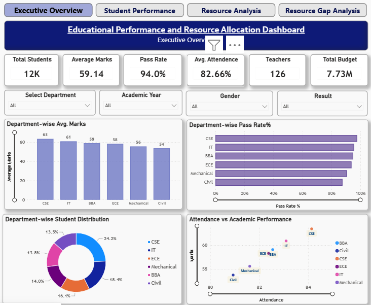
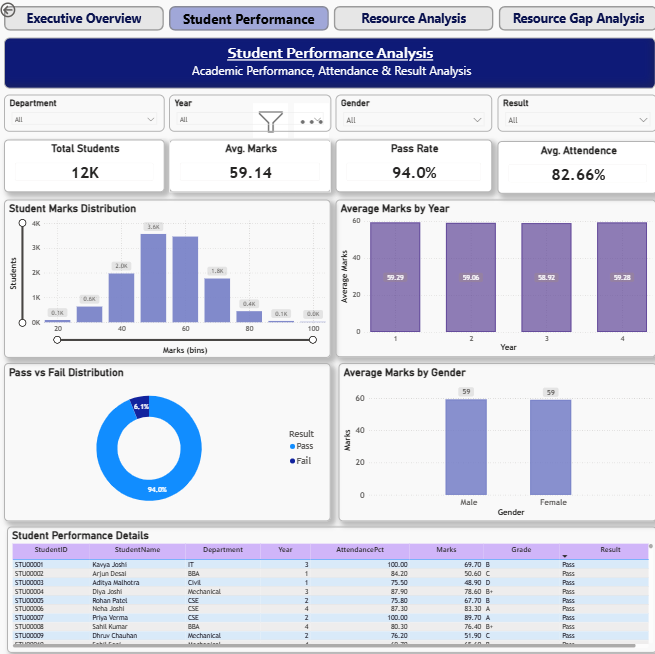
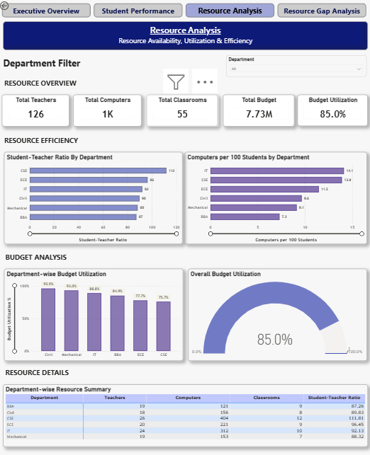
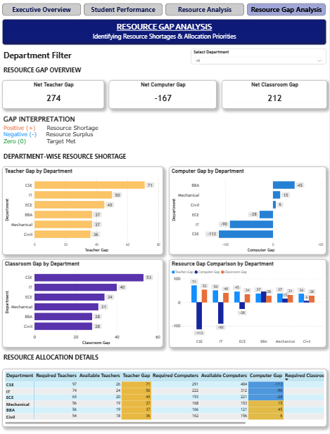

# 🎓 Educational Performance & Resource Allocation Dashboard

## 📌 Project Overview

This project is an interactive **Power BI dashboard** developed as part of my **CodeAlpha task**. It analyzes student academic performance and evaluates the availability and utilization of educational resources across departments.

The dashboard helps users understand student performance, attendance, pass rates, resource utilization, budget allocation, and resource shortages.

## 🎯 Project Objectives

- Analyze student marks, grades, attendance, and pass rates.
- Compare academic performance across departments, academic years, and genders.
- Monitor teachers, computers, classrooms, and budget utilization.
- Identify potential resource shortages and allocation priorities.
- Present insights through interactive Power BI visualizations.

## 📊 Dashboard Pages

### 1. Executive Overview
Provides a summary of student performance and resource availability through KPI cards and department-wise charts.

### 2. Student Performance Analysis
Analyzes marks distribution, average marks, attendance, pass/fail distribution, and individual student performance.

### 3. Resource Analysis
Evaluates teacher availability, computers per 100 students, classroom resources, and budget utilization.

### 4. Resource Gap Analysis
Compares required and available teachers, computers, and classrooms to identify potential shortages and surpluses.

## 🛠️ Tools & Technologies

- **Power BI Desktop** — Dashboard development and visualization
- **DAX** — Measures and calculations
- **Microsoft Excel** — Dataset preparation
- **Data Analysis** — Performance and resource analysis

## 📈 Key Features

- Interactive department, academic year, gender, and result filters
- KPI cards for key performance indicators
- Department-wise performance comparisons
- Attendance and academic performance analysis
- Budget utilization monitoring
- Resource gap calculations
- Conditional formatting to highlight shortages and surpluses

## 🧮 DAX Concepts Used

- `DISTINCTCOUNT`
- `AVERAGE`
- `CALCULATE`
- `DIVIDE`
- `SUM`
- `CEILING`

These functions were used to calculate student counts, average marks, pass rates, resource totals, budget utilization, and estimated resource gaps.

## 📁 Dataset

The project uses educational data covering student details, academic performance, department-level resources, and subject information.

**Note:** Please ensure the dataset can be publicly shared before uploading it to GitHub.

## 💡 Key Learning Outcomes

- Building multi-page interactive Power BI dashboards
- Creating DAX measures
- Designing meaningful data visualizations
- Analyzing academic and resource-related metrics
- Applying conditional formatting
- Presenting data-driven insights

## 👩‍💻 About Me

**Ashvini Pal**  
B.Tech CSE — Specialization in Data Science  
ITM Vocational University, Vadodara  
Aspiring Data Analyst

I am continuously improving my skills in Power BI, SQL, Excel, and data analytics by working on practical projects.

## 🏷️ Tags

#Power BI #Data Analytics #DAX #Dashboard #Data Visualization #Excel #CodeAlpha

## 🖼️ Dashboard Screenshots

## 🖼️ Dashboard Screenshots

### Page 1: Executive Overview

### Page 2: Student Performance Analysis

### Page 3: Resource Analysis

### Page 4: Resource Gap Analysis

